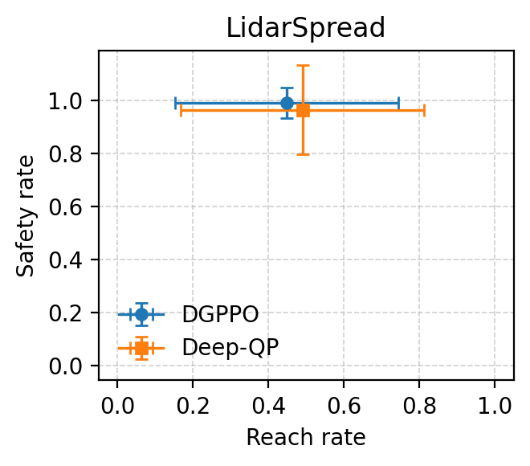
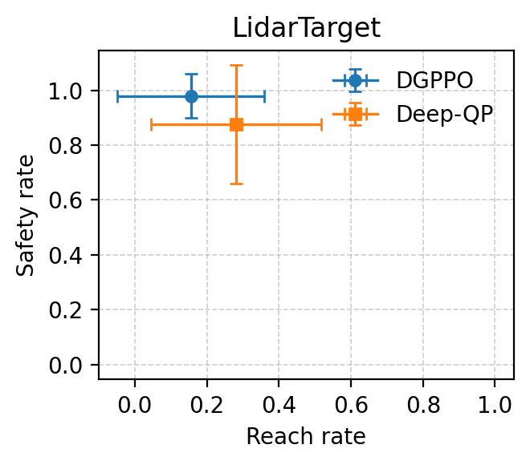
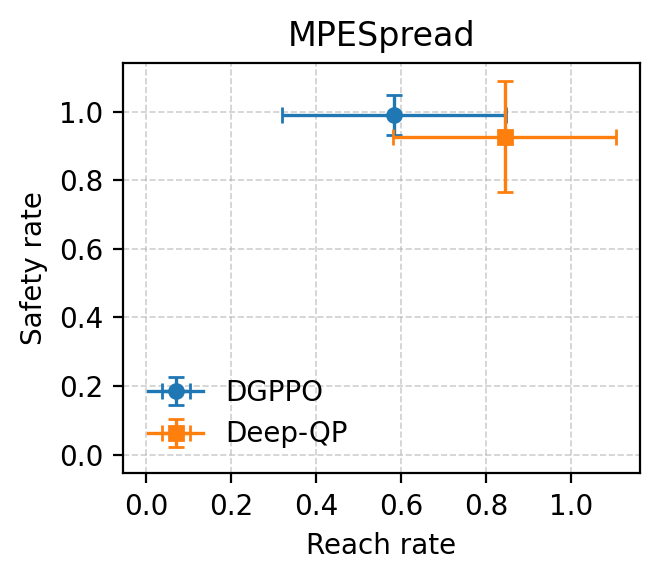
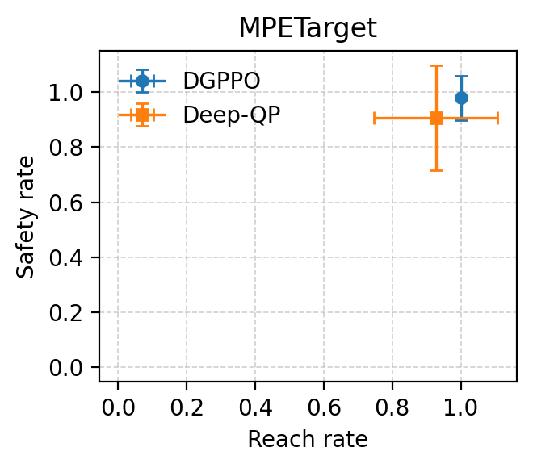
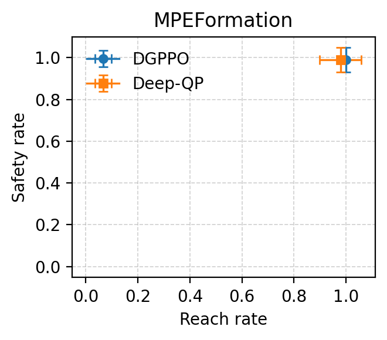
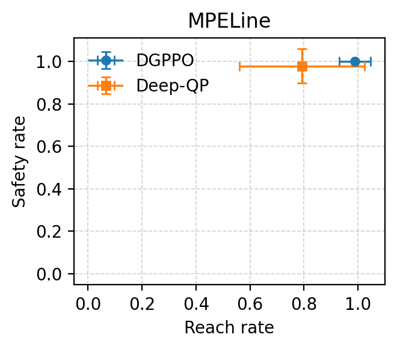
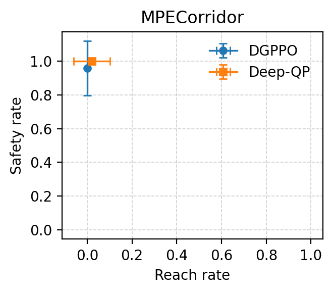

# MPE 与 Lidar：DGPPO / Deep-QP Safety Rate 和 Reach Rate 对比


## Safety rate

| 环境 | DGPPO | Deep-QP | Δ |
|---|---:|---:|---:|
| LidarSpread | 98.958% ± 5.800% | 96.354% ± 16.788% | -2.604 |
| LidarTarget | 97.917% ± 8.069% | 87.500% ± 21.651% | -10.417 |
| MPECorridor | 95.833% ± 16.137% | 100.000% ± 0.000% | +4.167 |
| MPESpread | 98.958% ± 5.800% | 92.708% ± 16.104% | -6.250 |
| MPETarget | 97.917% ± 8.069% | 90.625% ± 19.066% | -7.292 |
| MPEFormation | 98.958% ± 5.800% | 98.958% ± 5.800% | 0.000 |
| MPELine | 100.000% ± 0.000% | 97.917% ± 8.069% | -2.083 |

## Reach rate

| 环境 | DGPPO | Deep-QP | Δ |
|---|---:|---:|---:|
| LidarSpread | 44.792% ± 29.591% | 48.958% ± 32.258% | +4.166 |
| LidarTarget | 15.625% ± 20.386% | 28.125% ± 23.731% | +12.500 |
| MPECorridor | 0.000% ± 0.000% | 2.083% ± 8.069% | +2.083 |
| MPESpread | 58.333% ± 26.352% | 84.375% ± 26.332% | +26.042 |
| MPETarget | 100.000% ± 0.000% | 92.708% ± 18.132% | -7.292 |
| MPEFormation | 100.000% ± 0.000% | 97.917% ± 8.069% | -2.083 |
| MPELine | 98.958% ± 5.800% | 79.167% ± 23.199% | -19.791 |

## Safety–reach 对照图

图中横轴为 reach rate，纵轴为 safety rate；横向和纵向误差棒分别是对应指标
在全部 evaluation episodes 上的标准差。

| LidarSpread | LidarTarget |
|---|---|
|  |  |

| MPESpread | MPETarget |
|---|---|
|  |  |

| MPEFormation | MPELine |
|---|---|
|  |  |

| MPECorridor |
|---|
|  |


## 复现命令

以 MPESpread 为例：

```bash
python scripts/safety_rate_eval.py \
  --env-log-dir logs/MPESpread \
  --algo dgppo deepqp \
  --episodes 32 \
  --eval-seed 1234 \
  --complete-only \
  --plot-path docs/figures/safety_reach/MPESpread.png
```
